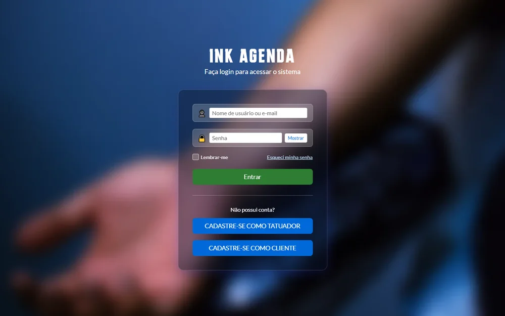
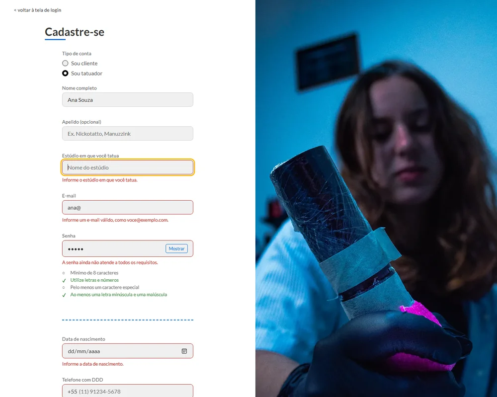
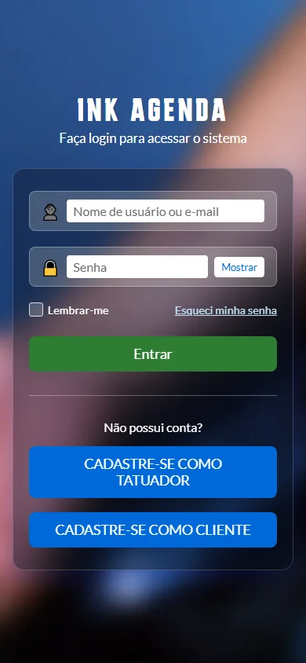
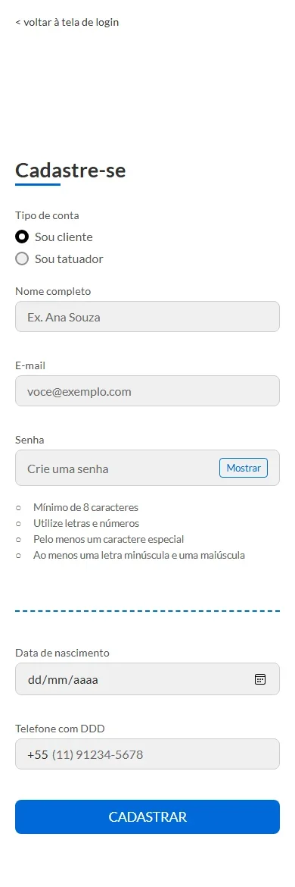

# INK AGENDA

Protótipo de uma plataforma para agendamento de tatuagens, que conecta **tatuadores** e **clientes**.
É um *front-end* completo e funcional no navegador (login e cadastro), feito só com **HTML, CSS e
JavaScript puros**, sem bibliotecas nem etapa de instalação.

> **Escopo:** é um protótipo de interface. Não há servidor nem banco de dados, então ninguém é de fato
> autenticado e nenhum cadastro é gravado. Os formulários mostram um aviso de demonstração.

## Telas

<p align="center">
  
  
</p>
<p align="center">
  
  
</p>

## O que o protótipo faz

- **Login** com validação, botão Mostrar/Ocultar senha e "Lembrar-me", que guarda **só o nome de usuário**
  neste navegador (a senha nunca é guardada).
- **Cadastro único** para cliente e para tatuador: o perfil vem do botão escolhido no login
  (`cadastro.html?tipo=tatuador`) ou da opção na própria página, e os campos de apelido e estúdio só
  aparecem para o tatuador.
- **Senha com requisitos em tempo real**: a lista (8 caracteres, letras e números, caractere especial,
  maiúscula e minúscula) acende em verde enquanto a pessoa digita.
- **Validação por campo**, com mensagem sob o campo, foco no primeiro erro, máscara de telefone
  `(11) 91234-5678` e checagem de data de nascimento (existe e não é futura).

## Decisões de projeto

| Tema | O que foi feito |
|---|---|
| **Peso da página** | O fundo e a foto do cadastro eram SVGs de 22 MB e 30 MB que só guardavam um PNG embutido. Foram extraídos e convertidos para WebP: **52 MB viraram 0,3 MB** e o visual ficou idêntico (diferença média de 1 a 2 níveis em 255) |
| **Responsivo** | Uma folha de estilos única, com variáveis de cor. A foto some abaixo de 900 px e o formulário rola em telas pequenas |
| **Acessibilidade** | Rótulos ligados aos campos (`label for`), `aria-invalid` e `aria-describedby` nos erros, foco do teclado sempre visível e `autocomplete` correto. Contraste das cores medido: texto sobre botões e campos fica **acima de 4,5:1** |
| **Código** | Regras de validação em um módulo puro (`scripts/validacao.js`), separado da página, para poder testá-lo |
| **Privacidade** | Nenhum dado sai do navegador; o envio dos formulários é interceptado, para a senha não aparecer na URL |

## Como abrir

Não há instalação. Baixe o repositório e abra o `index.html` no navegador.

## Testes

Abra `tests/validacao.test.html` no navegador: são **38 testes** das regras de validação (senha, telefone,
e-mail e data). O resultado aparece na página e no título da aba.

## Estrutura

```
index.html           login
cadastro.html        cadastro de cliente e de tatuador
styles/main.css      estilos (variáveis, componentes, login, cadastro, responsivo)
scripts/
  validacao.js       regras de validação (funções puras)
  comum.js           erros nos campos, mostrar/ocultar senha, avisos
  login.js           comportamento do login
  cadastro.js        comportamento do cadastro
tests/               testes das regras de validação
assets/images/       fundo e foto em WebP
docs/telas/          capturas de tela deste README
```

## Próximos passos

- Servidor e banco de dados para login e cadastro reais, com a senha guardada de forma segura (hash).
- Agenda: horários do tatuador, pedido de orçamento e confirmação de sessão.
- Recuperação de senha por e-mail.

## Autor

Pedro Paulo – Engenharia de Software, UNISA.
